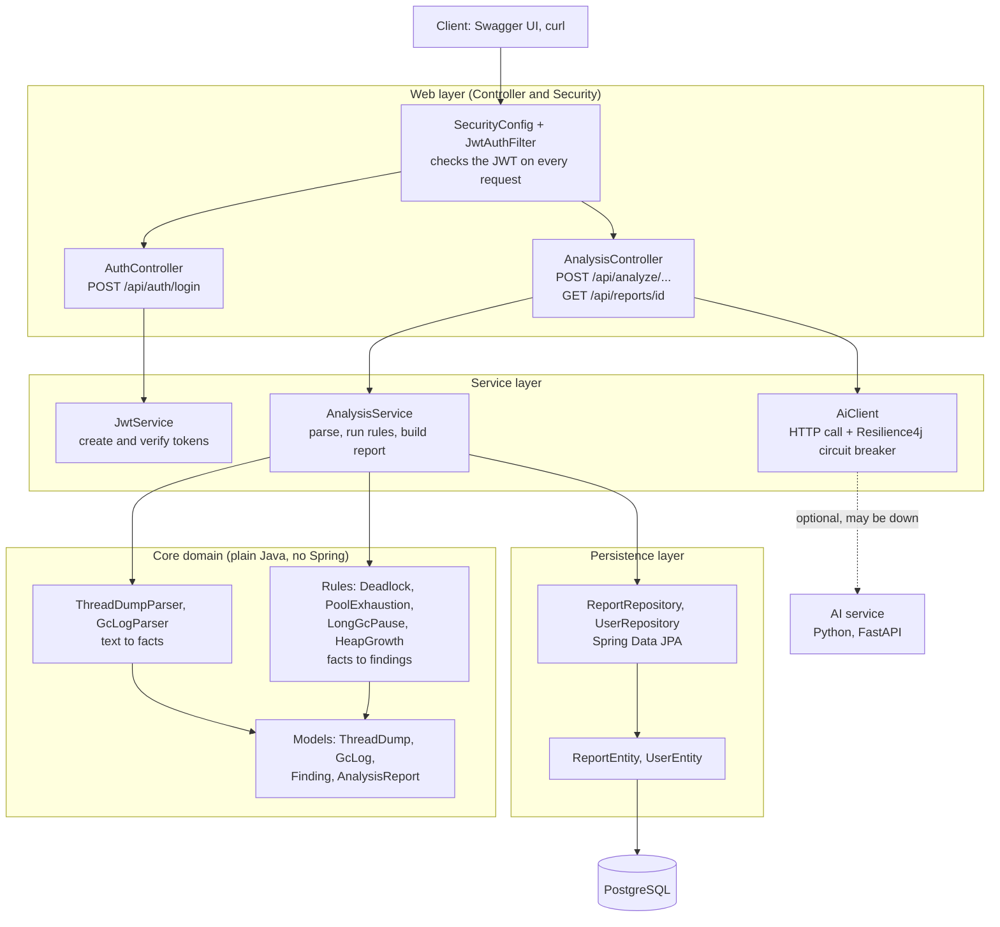
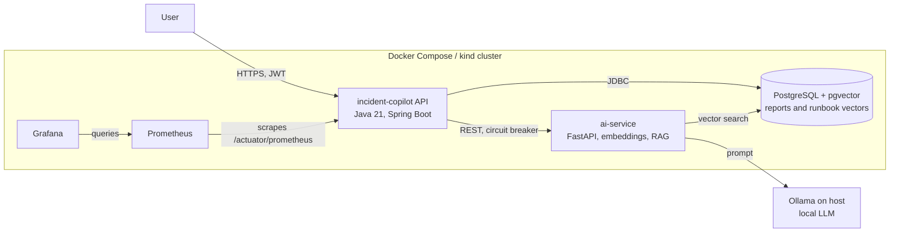
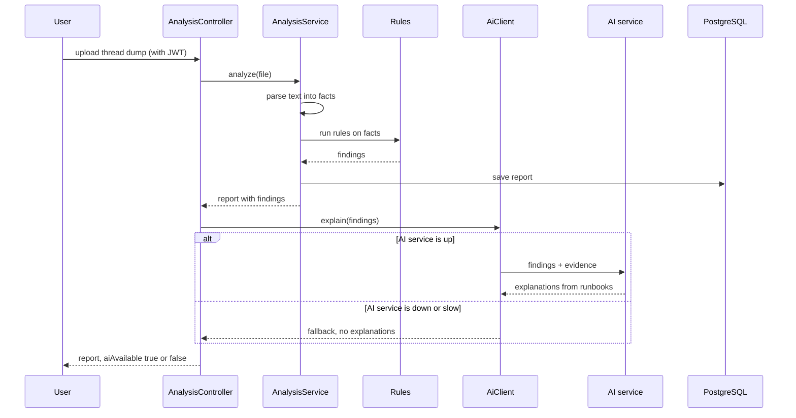
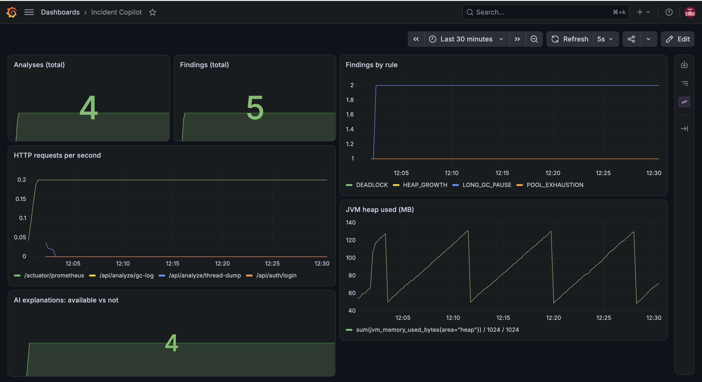

# jvm-incident-copilot


A personal project: a Java service that reads JVM thread dumps and GC logs, turns them into verified findings, and can optionally explain each finding using a local AI model.

The idea behind it is simple. **Facts and findings come from plain Java code and rules. The AI never decides what is wrong. It only explains a finding that is already proven.** If the AI service is down, the tool still works.

## How it works

### Layers inside the Java API



### System architecture



### One request, step by step



- **Parsers** read the raw text into structured facts (threads, locks, GC events).
- **Rules** turn facts into findings with evidence, for example a deadlock found by looking for a cycle in the lock wait graph.
- **AI layer** gets only the finding, its evidence and the matching runbook text, and is told not to invent anything.
- **Circuit breaker**: if the AI service is slow or down, the API returns the findings without explanations and says `aiAvailable: false`.

## Tech stack

- Java 21, Spring Boot 3.5, Spring Security with JWT, Spring Data JPA
- PostgreSQL with pgvector
- Resilience4j, Micrometer, Prometheus, Grafana
- Python 3.12, FastAPI, sentence-transformers, Ollama (local model)
- Docker and Docker Compose, Kubernetes manifests (kind), GitHub Actions
- JUnit 5, Mockito, Testcontainers, pytest

## Run it with Docker Compose

Needs Docker. For the AI explanations you also need Ollama running on your machine. Without it the tool still works and reports `aiAvailable: false`.

```
git clone https://github.com/maheshpasayat/jvm-incident-copilot.git
cd jvm-incident-copilot
docker compose up --build
```

| Service    | URL                                   |
|------------|---------------------------------------|
| API        | http://localhost:8080                 |
| Swagger UI | http://localhost:8080/swagger-ui.html |
| Prometheus | http://localhost:9090                 |
| Grafana    | http://localhost:3000                 |

**Log in** (demo account for local use only, not a real secret):

```
curl -X POST http://localhost:8080/api/auth/login \
  -H "Content-Type: application/json" \
  -d '{"username":"admin","password":"admin123"}'
```

Copy the token from the response. In Swagger UI click Authorize and paste it. Then use the upload endpoints with the files in `samples/`:

- `POST /api/analyze/thread-dump` (for example `samples/thread-dumps/deadlock.txt`)
- `POST /api/analyze/gc-log` (for example `samples/gc-logs/gc-pressure.log`)
- `GET /api/reports/{id}` to read a saved report

## Run it on Kubernetes (kind)

The `k8s/` folder has manifests for the API, the AI service and PostgreSQL, with readiness and liveness probes. The API is exposed on port 8080 through a NodePort.

```
kind create cluster --name copilot --config k8s/kind-config.yaml
# build the images, load them into kind (kind load docker-image <image> --name copilot)
kubectl apply -f k8s/
kubectl get pods
```

Image names are set in the `k8s/*.yaml` files. Delete the cluster with `kind delete cluster --name copilot`.

## Run the tests

```
mvn test                              # 40 Java tests (needs Docker for Testcontainers)
cd ai-service && python -m pytest     # 9 Python tests
```

CI runs both on every push (see the badge above).

## Results

Run against the sample files in `samples/`:

- `deadlock.txt` and `real-deadlock.txt`: deadlock found, with the threads and locks in the cycle.
- `pool-exhaustion.txt`: pool exhaustion found (many threads blocked on the same resource).
- `gc-pressure.log` and `memory-leak.log`: long GC pauses and heap growth findings.
- `real-*` files were captured from a small Java program on my own machine (`jcmd Thread.print` and `-Xlog:gc`), not written by hand.

Grafana dashboard with the custom metrics from the API:



## Honest scope

- This is a **personal learning project**. It has only been run locally. It is not production software and has no real users.
- Java 21. Not tested on other JDK versions.
- The GC parser reads the unified logging format (`-Xlog:gc`) pause lines. Other GC log formats are not supported.
- The real GC log in `samples/` (a small program that ran out of memory) gives **24 facts and no findings**. That is correct: it has no 3 or more Full GCs and no pause of 200 ms or more, so those rules stay silent. The rules are simple thresholds, not a full diagnosis engine.
- The AI layer is a small local model, grounded on four runbooks. It explains findings. It does not find them. It is not an AI agent.
- The Python part is a small FastAPI service written for this project.
- Demo passwords in the config are for local use only.

## Project layout

```
src/                 Java API, parsers, rules, tests
ai-service/          Python FastAPI service, runbooks, tests
samples/             thread dumps and GC logs (synthetic and real captures)
monitoring/          Prometheus and Grafana config and dashboard
k8s/                 Kubernetes manifests for kind
.github/workflows/   CI
docs/                screenshots
```